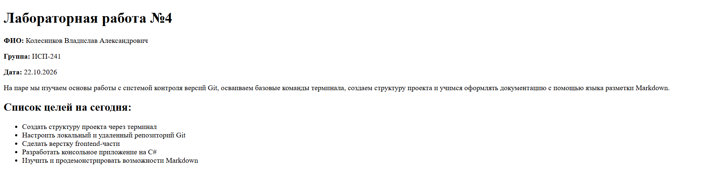

# Лабораторная работа №4: Markdown

**ФИО:** Колесников Владислав Александрович  
**Группа:** ИСП-241 (3 курс)  
**Дата:** 22.10.2026

---

## 1. Заголовки всех уровней

# Заголовок H1

## Заголовок H2

### Заголовок H3

#### Заголовок H4

##### Заголовок H5

###### Заголовок H6

## 2. Горизонтальные линии

Вот пример линии:

---

А вот еще одна:

---

## 3. Форматирование текста

- **Жирный текст** (жирный)
- _Курсив_ (курсив)
- ~~Зачёркнутый текст~~ (зачёркнутый)
- `Моноширный текст` (моноширный)

## 4. Списки

**Маркированный список:**

- Пункт 1
- Пункт 2
- Пункт 3

**Нумерованный список:**

1. Первый шаг
2. Второй шаг
3. Третий шаг

**Вложенный список:**

- Основной пункт
  - Вложенный пункт 1
  - Вложенный пункт 2
    - Глубоко вложенный пункт

## 5. Цитаты

> Это пример цитаты.
> Она может занимать несколько строк.

## 6. Блоки кода

Пример работы с Git в терминале:

```bash
git status
git add .
git commit -m "Update"
```

## 7. Таблица

| Инструмент |     Назначение     | Уровень владения |
| :--------- | :----------------: | ---------------: |
| Git        |  Контроль версий   |          Высокий |
| Markdown   |    Документация    |          Средний |
| C#         | Backend разработка |          Базовый |

## 8. Картинка из папки repo/



## 9. Ссылки

- [Внешняя ссылка на GitHub](https://github.com)
- [Внутренняя ссылка на главный README](../README.md)

## 10. Чекбоксы

- [x] Сделано
- [ ] Не сделано

## 11. Alert-блоки GitHub

> [!NOTE]
> Это пример полезного примечания.

## 12. Inline LaTeX

Формула квадрата гипотенузы: $a^2 + b^2 = c^2$

## 13. Block LaTeX

Формула суммы арифметической прогрессии:

$$
\sum_{i=1}^n i = \frac{n(n+1)}{2}
$$
